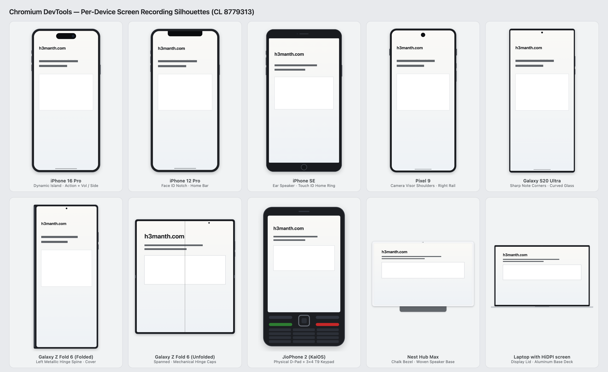

# Explainer: Device-Framed Viewport Capture API & WebDriver BiDi Integration

**Author:** Hemanth HM (`@hemanth`, `hemanth.hm@gmail.com`)
**Incubation Targets:**
1. **Web Platform API:** [WICG](https://github.com/WICG/proposals) -> [W3C WebRTC WG (`mediacapture-screen-share` / `mediacapture-viewport`)](https://github.com/w3c/mediacapture-viewport)
2. **Browser Automation & DevTools Protocol:** [W3C Browser Testing and Tools WG (`w3c/webdriver-bidi`)](https://github.com/w3c/webdriver-bidi)
**Reference Implementation:** Chromium DevTools ([CL 8779313](https://chromium-review.googlesource.com/c/devtools/devtools-frontend/+/8779313) / [crbug.com/40521790](https://issues.chromium.org/issues/40521790))

---

## 1. Introduction & Motivation

Web applications and developer tools increasingly capture live browser viewports and embedded preview surfaces:
- **In-browser IDEs, design sandboxes, and AI app builders** (Storybook, StackBlitz, CodeSandbox, CodePen, Figma, v0, Bolt, Replit) capture live responsive `<iframe sandbox>` previews using [Viewport Capture (`getViewportMedia`)](https://www.w3.org/TR/mediacapture-viewport/) + [Element Capture (`RestrictionTarget`)](https://screen-share.github.io/element-capture/) to export product demos and walkthroughs.
- **In-app bug-reporting & session-replay tools** (Jam, Loom, Sentry/Highlight, Bird Eats Bug) record user sessions on mobile, tablet, and foldable viewports.
- **Browser DevTools, CI test runners, and multimodal AI agents** ([`w3c/webdriver-bidi#636`](https://github.com/w3c/webdriver-bidi/issues/636), [`#1054`](https://github.com/w3c/webdriver-bidi/issues/1054), [`#1164`](https://github.com/w3c/webdriver-bidi/issues/1164)) record screencasts and visual-regression snapshots of emulated mobile and foldable hardware.

### Three gaps in the platform today

1. **Physical screen obstructions are invisible to capture APIs:**
   Real mobile, foldable, and wearable screens are **non-rectangular**. They clip corners (`32px-55px` radii), punch camera cutouts (`pill`, `circle`, `notch`) directly through the upper viewport, and split dual-screen/foldable panels across physical hinges. Even when CSS `env(safe-area-inset-*)` or `env(viewport-segment-*)` is active, `getViewportMedia()`, `getDisplayMedia()`, `browsingContext.captureScreenshot`, and `browsingContext.startScreencast` capture the **unclipped rectangular backing store**. UI accidentally placed behind a Dynamic Island, punch-hole camera, rounded corner, or hinge appears 100% legible in captured videos and visual tests while being physically occluded on real hardware.
2. **Main-thread `<canvas>` re-compositing is slow, lossy, and drops audio sync:**
   Today, if a web app wants to record a responsive preview `<iframe>` inside a device frame, it must:
   1. Capture the tab via `getViewportMedia()` + `restrictTo(iframeTarget)`,
   2. Pump every `VideoFrame` to the main thread or worker via `MediaStreamTrackProcessor` / `<video>` + `requestVideoFrameCallback`,
   3. Redraw vector bezels, shadows, rounded-corner clips, and cutouts onto an `<OffscreenCanvas>`,
   4. Re-capture via `canvas.captureStream()` and manually splice the original audio track back into a new `MediaStream`.
   Under main-thread load (exactly when profiling or interacting with a heavy app!), frame pacing degrades and audio/video timestamps drift.
3. **Mid-recording device rotation breaks video pipelines:**
   Rotating a responsive preview (`393x852` -> `852x393`) or unfolding a foldable (`412x968` -> `744x860`) mid-recording emits mid-stream resolution changes on raw viewport tracks, breaking hardware H.264/VP9 encoders (especially on odd CSS pixel widths like `393px` with `4:2:0` chroma subsampling) and downstream MP4/WebM players.



---

## 2. Proposed Web Platform API (`CaptureController.prototype.setDeviceFrame`)

Following the established W3C Screen Capture pattern where post-capture surface transformations live on [`CaptureController`](https://www.w3.org/TR/screen-capture/#capturecontroller) (alongside Region Capture's `cropTo()` and Element Capture's `restrictTo()`), we propose adding **`controller.setDeviceFrame(configuration)`**:

```webidl
enum CaptureFramingMode {
  "none",
  "occlusions",
  "device"
};

enum DeviceFormFactor {
  "phone",
  "foldable",
  "feature-phone",
  "tablet",
  "notebook",
  "smart-display",
  "watch",
  "desktop"
};

enum DisplayCutoutShape {
  "pill",
  "circle",
  "notch",
  "rectangle"
};

enum CaptureRotationBehavior {
  "resize",
  "contain"
};

dictionary DisplayCutoutInit {
  required DisplayCutoutShape shape;
  required unsigned long x;
  required unsigned long y;
  required unsigned long width;
  required unsigned long height;
  unsigned long borderRadius = 0;
};

dictionary DisplayHingeInit {
  required DOMString orientation; // "vertical" | "horizontal"
  required unsigned long offset;
  required unsigned long maskLength;
};

dictionary DeviceFrameConfiguration {
  CaptureFramingMode mode = "device";
  DeviceFormFactor formFactor = "phone";
  (unsigned long or sequence<unsigned long>) cornerRadius = 0;
  sequence<DisplayCutoutInit> cutouts = [];
  DisplayHingeInit? hinge = null;
  CaptureRotationBehavior rotationBehavior = "contain";
  DOMString stageBackground = "#f1f3f4";
};

partial interface CaptureController {
  Promise<undefined> setDeviceFrame(optional DeviceFrameConfiguration? configuration = null);
};
```

### Key behaviors

1. **Three framing modes:**
   - `"none"` (or `setDeviceFrame(null)`): Raw rectangular surface capture (existing default).
   - `"occlusions"`: Preserves surface dimensions while masking `cornerRadius` and compositing `cutouts` + `hinge` occlusions over the captured surface.
   - `"device"`: Composites the occlusion-masked surface inside a vendor-neutral form-factor chassis (`phone`, `foldable`, `tablet`, `notebook`, `smart-display`, `watch`, `desktop`) centered on `stageBackground`.
2. **Codec-safe `2n` output dimensions:**
   In `"device"` mode, output frame dimensions are rounded to even integers (`2n`) so `4:2:0` hardware encoders (`MediaRecorder`, WebCodecs `VideoEncoder`, WebRTC) never fail on odd CSS viewport dimensions.
3. **Live updates & rotation-invariant `contain` mode:**
   Calling `controller.setDeviceFrame(...)` again during an active recording updates form-factor posture (e.g. folded -> unfolded) or orientation dynamically. When `rotationBehavior` is `"contain"`, the output video track maintains fixed `(width, height)` dimensions locked when framing began, cleanly letterboxing/fitting rotated postures inside the locked stage.

### Example: Recording an interactive mobile preview `<iframe>` in an online IDE

```js
const controller = new CaptureController();
const stream = await navigator.mediaDevices.getViewportMedia({
  video: { frameRate: 60 },
  audio: true,
  controller,
});

const preview = document.querySelector('iframe#preview');
const target = await RestrictionTarget.fromElement(preview);
await stream.getVideoTracks()[0].restrictTo(target);

await controller.setDeviceFrame({
  mode: 'device',
  formFactor: 'phone',
  cornerRadius: 39,
  cutouts: [
    { shape: 'pill', x: 134, y: 11, width: 125, height: 37, borderRadius: 19 },
  ],
  rotationBehavior: 'contain',
});

const recorder = new MediaRecorder(stream, { mimeType: 'video/webm;codecs=vp9' });
recorder.start();

// User rotates preview mid-recording; output stream dimensions stay constant!
preview.style.width = '852px';
preview.style.height = '393px';
```

---

## 3. Companion W3C WebDriver BiDi Specification Hook

Just as `browsingContext.startScreencast` in `w3c/webdriver-bidi` ([PR #1069](https://github.com/w3c/webdriver-bidi/pull/1069) / [PR #1113](https://github.com/w3c/webdriver-bidi/pull/1113)) hooks into W3C Viewport Capture ([`w3c/mediacapture-viewport#34`](https://github.com/w3c/mediacapture-viewport/pull/34)), WebDriver BiDi can expose the exact same framing pipeline to DevTools, CI runners, and AI agents via two small, backwards-compatible extensions:

### 3.1 `emulation.setDisplayFeaturesOverride`

Complements `emulation.setSafeAreaInsetsOverride` ([`w3c/webdriver-bidi#1054`](https://github.com/w3c/webdriver-bidi/issues/1054) / [PR #1077](https://github.com/w3c/webdriver-bidi/pull/1077)) with geometric screen masks:

```cddl
emulation.SetDisplayFeaturesOverride = (
  method: "emulation.setDisplayFeaturesOverride",
  params: emulation.SetDisplayFeaturesOverrideParameters
)

emulation.SetDisplayFeaturesOverrideParameters = {
  features: emulation.DisplayFeatures / null,
  ? contexts: [+browsingContext.BrowsingContext],
  ? userContexts: [+browser.UserContext],
}

emulation.DisplayFeatures = {
  ? formFactor: "phone" / "foldable" / "feature-phone" / "tablet" / "notebook" / "smart-display" / "watch" / "desktop",
  ? cornerRadius: js-uint / [js-uint, js-uint, js-uint, js-uint],
  ? cutouts: [*emulation.DisplayCutout],
  ? hinge: emulation.DisplayHinge / null,
  ? posture: "continuous" / "folded",
}
```

### 3.2 `framing` on `browsingContext.captureScreenshot` & `browsingContext.startScreencast`

```cddl
browsingContext.CaptureFraming = "none" / "occlusions" / "device"

; Added to browsingContext.CaptureScreenshotParameters & browsingContext.StartScreencastParameters:
;   ? framing: browsingContext.CaptureFraming .default "none"
```

---

## 4. Alternatives Considered

1. **Userland `<canvas>` + `MediaStreamTrackProcessor` / `MediaStreamTrackGenerator`:**
   Requires copying every decoded frame through JS/Worker memory, re-implementing vector bezels/cutouts/hinge geometry in every tool, manually re-muxing audio, and is unavailable to non-JS WebDriver BiDi `browsingContext.startScreencast` file recordings ([PR #1113](https://github.com/w3c/webdriver-bidi/pull/1113) explicitly designed BiDi screencasting *without* requiring JS execution in the target realm).
2. **Bundling raster `.png`/`.avif` OEM device skins:**
   Creates trademark/licensing barriers for open-source browsers and scales poorly across arbitrary viewport dimensions, custom foldable postures, and HiDPI factors. Procedural vector silhouettes parameterized by `(formFactor, cornerRadius, cutouts, hinge)` are resolution-independent and trademark-free.
3. **Putting `deviceFrame` inside `MediaTrackConstraints` (`video: { ... }`):**
   `MediaTrackConstraints` models hardware camera/sensor selection and negotiation (`min`/`max`/`exact`/`ideal`), whereas `CaptureController` is the established home for display-capture presentation controls (`setFocusBehavior`, `restrictTo`, `cropTo`).

---

## 5. Security, Privacy & Fingerprinting Considerations

- **Zero passive hardware fingerprinting:** `DeviceFrameConfiguration` only accepts caller-supplied synthetic geometry. It does **not** read or expose the end user's physical device model, hardware notch dimensions, or bezel color to web pages.
- **Permission parity with Screen Capture:** `CaptureController.prototype.setDeviceFrame()` only operates on capture sessions already authorized by the user via `getViewportMedia()` or `getDisplayMedia()`, and respects Element Capture / Region Capture cross-origin isolation rules (`RestrictionTarget` / `CropTarget`).
- **Trademark neutrality:** Standard `DeviceFormFactor` values describe generic hardware archetypes (`"phone"`, `"foldable"`, `"tablet"`, `"notebook"`, `"smart-display"`, `"watch"`, `"desktop"`), never vendor-specific product names.

---

## 6. Implementation Experience

We implemented and validated the vector composition pipeline, live orientation/posture transitions, `2n` codec alignment, cutout co-rotation, and form-factor silhouettes in Chromium DevTools:
- **Gerrit CL:** [https://chromium-review.googlesource.com/c/devtools/devtools-frontend/+/8779313](https://chromium-review.googlesource.com/c/devtools/devtools-frontend/+/8779313)
- **Chromium Issue:** [https://issues.chromium.org/issues/40521790](https://issues.chromium.org/issues/40521790)
